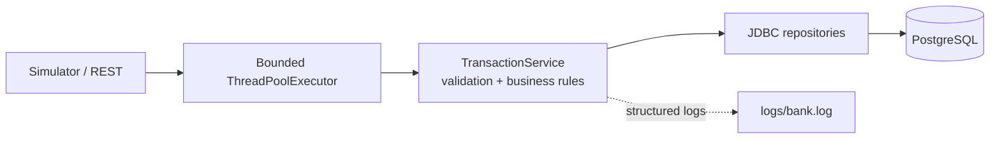

# Design note

## Architecture


## ER diagram
```mermaid
erDiagram
  CUSTOMERS ||--o{ ACCOUNTS : owns
  TRANSACTIONS ||--o{ TRANSACTION_AUDIT : audited_by
  TRANSACTIONS ||--o| FAILED_TRANSACTIONS : explained_by
  CUSTOMERS { bigint customer_id PK  varchar name  varchar email UK }
  ACCOUNTS { bigint account_id PK  bigint customer_id FK  numeric balance "CHECK >= 0"  varchar status }
  TRANSACTIONS { varchar transaction_id PK  varchar type  numeric amount  varchar status  bigint source_account_id  bigint destination_account_id }
  TRANSACTION_AUDIT { bigint audit_id PK  varchar transaction_id FK  timestamptz event_time  varchar thread_name  bigint duration_ms }
  FAILED_TRANSACTIONS { varchar transaction_id PK_FK  varchar error_category  varchar reason }
```
`transactions` has no FK to `accounts` on purpose: requests for unknown accounts or with invalid data must still be stored as REJECTED.

## Concurrency approach: pessimistic row locking
Every operation runs in one DB transaction (READ COMMITTED) and takes `SELECT ... FOR UPDATE` on the account rows
before checking balance and updating.
- **Lost updates:** the second writer waits for the row lock, then reads the committed balance.
- **Dirty outcomes:** a "SUCCESS" is returned only after `COMMIT`; any failure rolls back (savepoint for business rejections, full rollback for system errors).
- **Negative balances:** the funds check happens while the row is locked, and `CHECK (balance >= 0)` is a last line of defence.
- **Deadlocks:** transfers lock the lower account id first, then the higher one. Deadlock/serialization errors (SQLState 40P01/40001) are still retried up to 3 times as a safety net.
- **Why not the alternatives:** optimistic locking needs bounded retries and does badly on hot accounts (the workload deliberately hammers 10 of them); an atomic `UPDATE ... WHERE balance >= x` is efficient for a single debit but makes multi-row transfers and audit-preserving rejections harder to reason about.

## Idempotency
1. Application check: `SELECT status FROM transactions WHERE transaction_id = ?`.
2. Database guarantee: `INSERT ... ON CONFLICT (transaction_id) DO NOTHING` (PK) is the claim. A concurrent duplicate blocks on the unique index until the first transaction ends, then gets 0 rows and is reported as a duplicate carrying the original outcome.
3. The claim row is inserted *before* any money moves, in the same DB transaction, so if the first attempt rolls back the claim disappears and a retry can proceed.
A replay of a FAILED/REJECTED id returns that stored outcome and moves no money; clients must use a new id to retry a failed payment.

## Outcomes
| Status | When | Persisted |
|---|---|---|
| SUCCESS | committed | transactions + audit |
| REJECTED | validation / business rule (invalid amount, unknown or inactive account, insufficient balance) | transactions + failed_transactions + audit |
| FAILED | unexpected system error after rollback | transactions + failed_transactions + audit (separate transaction) |
Duplicates are logged (WARN) and returned to the caller but create no new rows. Audit rows record the thread and duration up to just before commit.

## Indexes (justified by workload)
| Index | Serves |
|---|---|
| PK `transactions(transaction_id)` | idempotency lookup + claim |
| `transactions(source_account_id)`, `(destination_account_id)` | customer history, top accounts, accounts > N |
| `transactions(created_at)` | daily reports |
| `accounts(customer_id)` | customer -> accounts join |
| `failed_transactions(error_category)` | failure report |
| `transaction_audit(transaction_id)` | audit lookup (FK column) |

## Performance results
_Run `PerformanceRunner` and paste `results/performance.md` here._

Analysis to write after the run (use your measured numbers): TPS should rise from 1 to ~5-10 workers and flatten or dip at 20 because
(a) hot accounts serialise on row locks (`Lock:transactionid` / `Lock:tuple` in the wait sampler), (b) the pool size equals the worker count so
more workers means more PostgreSQL backends competing for CPU and WAL fsync (`IO:WALSync`), (c) each transaction does ~5 round trips and a commit fsync,
(d) coordination overhead in the executor queue. Mention that success/rejected counts differ slightly between runs because which withdrawals find enough balance depends on execution order, while the integrity check is identical every time.

## SQL query analysis
_Run `explain.sql` and record observations (index vs sequential scan, row estimates vs actual, timing) for Q1-Q5 in `docs/explain-output.txt`._

## Limitations / possible extensions
REST API (Spring Boot), Micrometer metrics and OpenAPI are optional extras not included; pagination for history reports; partitioning `transactions` by date for very large volumes.
